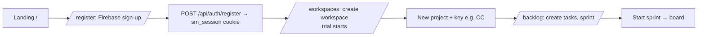

# 04 User Journeys

The FLOWS home. This file is the **index and the cross-module journeys**; each module doc owns the
step-by-step detail of its own journeys under "Key journeys" (happy path, permission / read-only branch,
failure and rollback). Personas: [03-user-personas.md](03-user-personas.md).

## Journey index

| Journey | Starts at | Detail |
|---|---|---|
| Sign up / sign in (Firebase → app session) | `/register`, `/login` | [api/auth.md](api/auth.md), [13-security.md](13-security.md) |
| Create workspace → project → configure | `/workspaces` | [modules/06-workspaces-projects.md](modules/06-workspaces-projects.md#key-journeys) |
| Edit workspace name / description | `/workspaces` → settings icon | [modules/06-workspaces-projects.md](modules/06-workspaces-projects.md#key-journeys) |
| Invite members / guests, change roles | workspace modal, project settings | [modules/04-roles-permissions.md](modules/04-roles-permissions.md#key-journeys) |
| Plan a sprint, start, complete | `/p/[projectId]/backlog` | [modules/02-backlog-sprints.md](modules/02-backlog-sprints.md#key-journeys) |
| Work the board (drag, quick create, bulk) | `/p/[projectId]/board` | [modules/01-kanban-board.md](modules/01-kanban-board.md#key-journeys) |
| Open / edit / share a task (Copy link) | any view → TaskModal | [modules/03-tasks.md](modules/03-tasks.md#key-journeys) |
| List / calendar / timeline views | `/p/[projectId]/list` etc. | [modules/05-list-calendar-timeline.md](modules/05-list-calendar-timeline.md#key-journeys) |
| Trial expires → read-only → plan assigned | any project page | [modules/07-billing-plans.md](modules/07-billing-plans.md#key-journeys) |
| Super admin assigns a plan / manages users | `/admin` | [modules/08-super-admin.md](modules/08-super-admin.md#key-journeys) |
| Dashboards and reports | `/dashboard`, `/p/[projectId]/reports` | [modules/09-dashboards-reports.md](modules/09-dashboards-reports.md#key-journeys) |
| Notifications, ⌘K search, activity | top bar (`src/components/AppShell.tsx`) | [modules/10-notifications-search-activity.md](modules/10-notifications-search-activity.md#key-journeys) |

## Journey: new team → first running sprint
**Persona:** Owner · **Trigger:** clicks "Start your free trial" on `/` · **Outcome:** an active sprint

1. Register; the server verifies the Firebase ID token and sets the app's own `sm_session` JWT cookie.
2. Create a workspace. It gets a plan and a trial end date by default (`WorkspaceSchema` in `src/models/index.ts`).
3. Create a project with a key (tasks become `CC-1`, `CC-2`…). Key collision in the workspace → 409.
4. Create tasks and a sprint in the backlog, drag tasks in, **Start**.

**Branches:** a guest only sees the projects they were invited to; a viewer sees everything but no write
controls; an expired workspace shows a red read-only banner and hides every write control (server returns 403).

## Journey: developer finishes a task
**Persona:** Editor · **Trigger:** notification or My Tasks · **Outcome:** task in a done-category status

1. Open the task from the notification link (`/p/<id>/board?task=<taskId>` — only the board reads `?task=`).
2. Drag the card to Done (or change status in the modal). The server stamps `completedAt`, logs activity and
   notifies watchers. There are three status write paths, see [api/tasks.md](api/tasks.md#status-write-paths).
3. Share the task with "Copy link" in the modal header.

**Failure:** if the server rejects the move, the optimistic card snaps back (board) or the field reverts (modal).

## Journey: trial ends
**Persona:** Owner + team · **Trigger:** `trialEndsAt` passes · **Outcome:** read-only until a plan is assigned

1. `resolveStatus` (`src/lib/plans.ts`) now returns `expired`. No write or cron job is involved.
2. Every role collapses to `project:view` (`src/lib/permissions.ts:getCapabilities`); the UI shows the banner and
   the plan badge "Expired · read-only". Data is never deleted.
3. The super admin assigns a paid plan in `/admin`, which sets the status to `active`. If a past plan end date is
   set, it must be cleared too.
