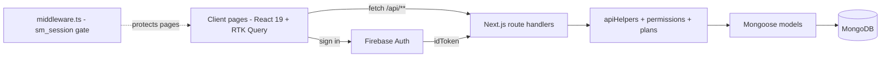

# 07 System Architecture

> Product-level summary. The canonical deep dive (diagram, core systems, security model,
> Next.js 16 footguns) is [`ARCHITECTURE.md`](ARCHITECTURE.md). Keep them consistent.

## Diagram

## Layers
- **Client:** `"use client"` pages under `src/app/(app)/` inside `src/components/AppShell.tsx:AppShell`.
  Server state lives in the RTK Query cache (`src/store/api.ts`), read through
  `src/store/hooks.ts:useQ`. Optimistic patches for drag & drop, list inline edit and task fields.
- **Middleware:** `src/middleware.ts` verifies the `sm_session` JWT; redirects anonymous users to
  `/login?next=…`, non-super-admins away from `/admin`, and signed-in users away from auth pages.
  `/` (landing) is public. `/api/**` is not matched.
- **API / handlers:** `src/app/api/**` — `withAuth()` → role/capability (+ expired-plan) check →
  zod `parseBody` → Mongoose → `logActivity`/`notify` → JSON. See [12-api-guidelines.md](12-api-guidelines.md).
- **Identity:** Firebase Auth issues the ID token; `POST /api/auth/login` verifies it and sets `sm_session`.
- **Data:** single MongoDB through a cached Mongoose connection; models in `src/models/index.ts`.
  See [`current-infrastructure/mongodb.md`](current-infrastructure/mongodb.md).

## Data Flow
A board drag (task → new column), `src/app/(app)/p/[projectId]/board/page.tsx:BoardPage`:
1. UI patches the `getTasks` cache entry for the current URL (`api.util.updateQueryData`) so the card moves instantly.
2. Calls `POST /api/tasks/reorder` (new `order`, and `status` if the column changed). The reorder
   route itself sets `completedAt`/`startedAt`, logs activity and notifies watchers on a status change.
3. If the status changed, the board **then** calls `PATCH /api/tasks/[id]` (awaited after step 2).
   Because reorder already wrote the new status, PATCH sees no status change and adds nothing —
   it is a redundant round-trip whose main effect is invalidating `Tasks`/`Task` so lists refetch.
   (The in-code comment "status change also needs the full PATCH" predates reorder doing this work.)
4. On any failure, `patch.undo()` rolls the card back.
5. Each handler runs `withAuth()` and checks `can(user, projectId, "task:edit")`; on an expired
   workspace that check fails (403) because capabilities collapse to `project:view`.
