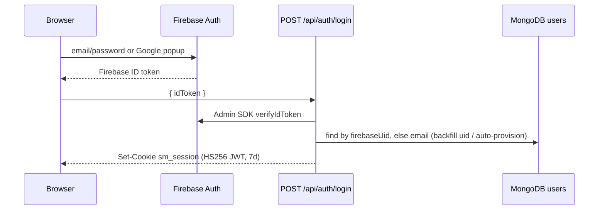

# 13 Security

## Access Control

### Authentication (two layers)
Firebase Auth owns credentials; the app owns the session.

- **Identity provider:** Firebase Web SDK in the browser (`src/lib/firebase/client.ts`) — email/password (`src/app/(auth)/login/page.tsx`), Google popup (`src/components/auth/GoogleSignInButton.tsx`), password reset email (`src/app/(auth)/forgot-password/page.tsx`). Details: [current-infrastructure/firebase.md](current-infrastructure/firebase.md).
- **Token exchange:** `POST /api/auth/login` / `POST /api/auth/register` verify the ID token with the Admin SDK (`src/lib/firebase/admin.ts:getAdminAuth`) and mint the app session. Contracts: [api/auth.md](api/auth.md).
- **Session:** `src/lib/auth.ts:signSession` signs `{ userId, email, name, role }` with `jose` HS256, 7-day expiry, stored in httpOnly cookie `sm_session` (`SESSION_COOKIE`), `sameSite: "lax"`, `secure` only when `NODE_ENV === "production"`.
- **Passwords are no longer handled by the app.** `User.passwordHash` is a legacy bcrypt field kept only for the Firebase import (`src/models/index.ts:UserSchema`). The old claim "email + password (bcrypt hash)" is outdated since `79ab40a`.

> [!WARNING]
> `JWT_SECRET` falls back to the literal `"dev-secret"` in BOTH `src/lib/auth.ts` and `src/middleware.ts`. If it is unset in production, anyone can forge an `sm_session`. Nothing fails loudly — set it on Cloud Run and keep the two reads in sync.

### Route gating
- `src/middleware.ts:middleware` verifies the JWT on every page route (matcher excludes `/api`, `_next`, static images). Public: `/` (exact match), `/login`, `/register`, `/forgot-password`. Unauthed → `/login?next=<path>`; authed on an auth page → `/dashboard`.
- `/admin` pages redirect to `/dashboard` unless the JWT `email` matches the super admin (see below).
- API routes are **not** covered by middleware; every handler calls `src/lib/apiHelpers.ts:withAuth`, which calls `src/lib/auth.ts:requireUser` (verifies the cookie, reloads the user, rejects missing or `active: false` users → `401`). Only `auth/login`, `auth/register`, `auth/logout` skip it.
- Next 16 deprecates the `middleware` file convention in favour of `proxy` (`node_modules/next/dist/docs/01-app/02-guides/upgrading/version-16.md`). The file still works; renaming is open work.

> [!WARNING]
> Sessions are stateless. Logout (`POST /api/auth/logout`) only deletes the cookie, and deactivating a user does not revoke an issued JWT. API calls stop immediately (`requireUser` checks `active`), but middleware still lets page shells render until the token expires.

### Super admin
- Anchored to one hard-coded email: `src/lib/constants.ts:SUPER_ADMIN_EMAIL`, checked via `isSuperAdminEmail` / `src/lib/permissions.ts:isSuperAdmin`. The DB `User.role` (`super_admin|member`) is set on register/auto-provision for display only and grants nothing.
- Rationale (code comment, `79ab40a`): exactly one super admin that cannot be granted by editing a role field. Changing the super admin is a code change + deploy.
- Super-admin powers: `PATCH /api/users/[id]` (activate/deactivate, designation), `GET /api/users?all=1`, `GET /api/workspaces?all=1` (every workspace + member emails), plan fields on `PATCH /api/workspaces/[id]`, `DELETE /api/workspaces/[id]` on any workspace. It does **not** grant project/task access. See [modules/08-super-admin.md](modules/08-super-admin.md).

### Authorization (RBAC)
- One role set — **owner / admin / editor / viewer** — at workspace and project level, resolved to capabilities via `ROLE_CAPS` in `src/lib/constants.ts`. Enforcement: `src/lib/permissions.ts:can` / `getCapabilities` in every mutating project-scoped route; UI gating on `myCapabilities` is UX only.
- Workspace managers (owner/admin) are checked with `isWorkspaceManager(getWorkspaceRole(...))`.
- **Expired plan = read-only for every role** (owner included): `getCapabilities` returns only `project:view` when `isProjectReadOnly`; workspace-level writes check `isWorkspaceExpired` and return `403` with `READ_ONLY_MESSAGE`. See [modules/07-billing-plans.md](modules/07-billing-plans.md).
- Full matrix and role semantics: [modules/04-roles-permissions.md](modules/04-roles-permissions.md).

## Access & Visibility (tenant isolation)
- Tenant = workspace. A workspace member holds their role on **every project** in it (computed in `getProjectRole`, not copied into `project.members`). `project.members` holds only **guests**; `project.excludedMembers` strips workspace-derived access from one project.
- List queries filter by membership, e.g. `GET /api/workspaces` uses `{ $or: [{ owner }, { "members.user" }] }`. Single-resource routes return `404 "…not found or access denied"` when the caller has no role, so existence is not leaked.
- Removing someone from a workspace revokes access to all its projects (unless they are a guest on one).

> [!WARNING]
> `GET /api/users` lets **any** authenticated user list up to 100 active users across all tenants (name, email, designation), and passes `q` straight into `$regex` without escaping. This is a cross-tenant directory leak and a regex-injection/ReDoS vector. Scope it to the caller's workspaces and escape `q` before relying on it. Contract: [api/auth.md](api/auth.md#get-apiusers).

## Secrets
- Env var inventory and which are client-exposed: [15-environment-setup.md](15-environment-setup.md) (the only home).
- Locally, secrets live in `.env` (git-ignored by `.gitignore` rule `.env*`). `.env.local` no longer exists; `.env.example` is the committed template. Never copy values from `.env` into docs, code, or logs. <!-- verify:ignore -->
- Production: Cloud Run runtime env vars / Secret Manager. `.dockerignore` and `.gcloudignore` exclude `.env*`, so nothing secret is baked into the image.
- Server-only modules (`src/lib/db.ts`, `src/models/index.ts`, `src/lib/auth.ts`, `src/lib/permissions.ts`, `src/lib/apiHelpers.ts`, `src/lib/firebase/admin.ts`) must never be imported into a `"use client"` file.
- `NEXT_PUBLIC_FIREBASE_*` are public by design (Firebase web config). `src/lib/firebase/client.ts` also hard-codes fallback literals for them, so the production bundle uses those literals unless build args are added.

## Data Access
- Single cached Mongoose connection (`src/lib/db.ts:dbConnect`); all DB access goes through `/api/**` handlers. See [current-infrastructure/mongodb.md](current-infrastructure/mongodb.md).
- Unique indexes block duplicates, e.g. `{ workspace, key }` on projects and `{ project, key }` on tasks — field-level detail in [database/entities.md](database/entities.md).
- User reads exclude the hash: `requireUser` and user routes use `.select("-passwordHash")`.

## Input Handling
- Request bodies are validated with zod via `src/lib/apiHelpers.ts:parseBody` → `422` with `path: message` list, or `400 "Invalid JSON body"`. Fields absent from a schema are stripped.
- Mongoose strict mode + enums constrain writes. User text is stored as-is and rendered as React text. The only `dangerouslySetInnerHTML` is the static theme bootstrap script in `src/app/layout.tsx` (no user input).
- Query strings are **not** schema-validated; see the `GET /api/users` warning above.

## Threat Model Notes
| Threat | Mitigation in code | Gap |
|---|---|---|
| Cross-tenant data exposure | membership filters, `getProjectRole`, `404` on no-access | `GET /api/users` lists all users |
| Privilege escalation | server-side `can()`; super admin pinned to `SUPER_ADMIN_EMAIL`; `PATCH /api/users/[id]` cannot set `role` | — |
| Session forgery / theft | signed HS256 JWT, httpOnly cookie, `secure` in prod | `"dev-secret"` fallback; no server-side revocation |
| Error detail leakage | JSON errors, no HTML 500s | `auth/login` and `auth/register` 500s echo the raw exception in `detail` (code comment: "Remove/gate once prod is stable") |
| Open redirect after login | — | `src/app/(auth)/login/page.tsx` does `router.push(params.get("next"))` without checking it is a relative path (inferred risk) |
| Account enumeration | forgot-password always reports success | `POST /api/auth/register` returns `409` for an existing email |
| Write on lapsed plan | `isProjectReadOnly` / `isWorkspaceExpired` | — |
