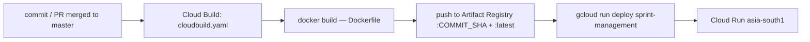

# 20 Deployment

## Environments
| Env | URL | Purpose |
|---|---|---|
| dev | http://localhost:3000 | local development (`npm run dev`) |
| production | Cloud Run service `sprint-management` | live hosted SaaS |

There is **no staging environment** (confirmed by the owner). Every push that reaches `master` goes to production.

> [!TODO]
> The production URL / custom domain and the Cloud Build trigger (which repo/branch fires `cloudbuild.yaml`) are configured in GCP, not in the repo. Needs a human.

## Pipeline


- **Image:** multi-stage `Dockerfile` (`deps` → `builder` → `runner`, all `node:22-alpine`). Uses `next.config.ts` `output: "standalone"`; runner copies `.next/standalone`, `.next/static`, `public`, runs `node server.js` as non-root user `nextjs` (uid 1001), `EXPOSE 8080`, `PORT=8080`, `HOSTNAME=0.0.0.0`.
- **Build config:** `next.config.ts` sets `typescript.ignoreBuildErrors` and `eslint.ignoreDuringBuilds` because full type-check + lint inside `next build` OOM-killed the Cloud Build worker (`90fc712`). `experimental.optimizePackageImports: ["lucide-react"]` keeps the icon barrel out of the bundle.
- **`cloudbuild.yaml`:** substitutions `_REGION=asia-south1`, `_REPO=apps`, `_SERVICE=sprint-management`; steps build → `push --all-tags` → `gcloud run deploy --image …:$COMMIT_SHA --port=8080 --allow-unauthenticated`. Logging `CLOUD_LOGGING_ONLY`.
- **Upload filters:** `.gcloudignore` / `.dockerignore` exclude `.env*` (except `.env.example`), `node_modules`, `.next`, `.git`. `.dockerignore` also drops `scripts/`, so the seed script is not in the image.

```bash
# manual run of the same pipeline
gcloud builds submit --config cloudbuild.yaml \
  --substitutions=_REGION=asia-south1,_REPO=apps,_SERVICE=sprint-management
```

## Config
Runtime env vars are set on the Cloud Run service, not in the image or in `cloudbuild.yaml` (its deploy step passes no `--set-env-vars`/`--set-secrets`, so existing service config carries over between revisions). Required at runtime: `MONGODB_URI`, `JWT_SECRET`, `FIREBASE_SERVICE_ACCOUNT` — full list and defaults in [15-environment-setup.md](15-environment-setup.md).
- Database: MongoDB Atlas (or another internet-reachable Mongo); Cloud Run has no local Mongo.
- Prefer `--set-secrets` (Secret Manager) over `--set-env-vars` for real secrets.
- `NEXT_PUBLIC_FIREBASE_*` are build-time only; the `Dockerfile` passes none, so prod uses the literal fallbacks in `src/lib/firebase/client.ts`.
- `README.md` and the `cloudbuild.yaml` header list only `MONGODB_URI`/`JWT_SECRET`; `FIREBASE_SERVICE_ACCOUNT` is missing there. A missing service account surfaces as `500` on login/register, not as a failed deploy (`src/lib/firebase/admin.ts:getAdminAuth` initialises lazily — added after a prod outage, per its comment).

> [!WARNING]
> Data migrations (root `migration*.js`) are **not** part of the pipeline. Run them by hand against the production `MONGODB_URI` before or right after the deploy that needs them — see [15-environment-setup.md](15-environment-setup.md#migrations). <!-- verify:ignore -->

## Rollback
- Cloud Run keeps revisions: route 100% traffic back to the previous one.
```bash
gcloud run services update-traffic sprint-management --region asia-south1 --to-revisions <REV>=100
```
- Images are tagged with `$COMMIT_SHA`, so a known-good build can be redeployed with `gcloud run deploy sprint-management --image asia-south1-docker.pkg.dev/<PROJECT_ID>/apps/sprint-management:<SHA>`.
- A rollback does not undo a data migration; document the `down` path in the migration itself.
