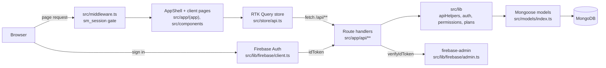

# System Architecture — Kanbo

## Overview

Kanbo is a hosted, transactional agile task-management SaaS (Jira/Linear-style) sold per
workspace and seat. It is one Next.js 16 App Router app (`next` 16.2.11, React 19.2) over a
single MongoDB datastore accessed through Mongoose. Identity comes from Firebase Auth;
the app then mints its own `sm_session` JWT. The browser talks only to `/api/**` route
handlers; those handlers authenticate, check capability-based permissions (including the
expired-plan read-only lock), validate with zod, and read/write MongoDB.

---

## Integration Strategy

There is a single backend (MongoDB). The seam that keeps the UI decoupled from the data
layer is the **API route layer** — UI never imports models.

1. **Phase 1 (current):** single MongoDB via Mongoose; all access behind `/api/**`.
   Server state cached client-side by RTK Query (migrated from SWR in `9b332de`).
2. **Phase 2 (not built):** if a service is extracted (e.g. notifications, reporting), it
   sits behind the same `/api/**` contract — UI components do not change.

Key invariant: **UI components never open a DB connection.** They call `/api/**` through
the RTK Query endpoints in `src/store/api.ts`; swapping or splitting the datastore only
touches route handlers + `src/models/`.

---

## Client Layer

- **Framework:** Next.js 16 App Router, React 19 — see [06-tech-stack.md](06-tech-stack.md) for exact versions.
- **Rendering:** every page under `src/app/(app)/` and `src/app/(auth)/` is a `"use client"`
  component. The only server-rendered page is the marketing landing `src/app/page.tsx`
  (reads `src/lib/auth.ts:getSession` to swap its CTA).
- **Shell:** `src/app/(app)/layout.tsx` wraps pages in `src/components/AppShell.tsx:AppShell`
  (sidebar, topbar, search, notifications, `useApp()` context with `me`/`workspaces`/`projects`).
- **Styling:** Tailwind CSS v4 + shared classes/tokens in `src/app/globals.css` — see [10-design-system.md](10-design-system.md).
- **UI library:** none — bespoke primitives in `src/components/ui.tsx` (see [ui/primitives.md](ui/primitives.md)); icons `lucide-react`.
- **Data fetching:** RTK Query (`@reduxjs/toolkit`) in `src/store/api.ts`, consumed through
  SWR-shaped wrappers `src/store/hooks.ts:useQ`. Details in [11-state-management.md](11-state-management.md).
- **Interactivity:** `@hello-pangea/dnd` for board/backlog drag & drop; optimistic cache patches.

---

## Backend / Aggregation Layer

No separate BFF: Next.js route handlers under `src/app/api/**` are the API. A typical handler:

1. `src/lib/apiHelpers.ts:withAuth` — `dbConnect()` + resolve the session user (401 if missing/inactive).
2. Permission check — `src/lib/permissions.ts:getProjectRole` / `getWorkspaceRole` / `can`
   (404 or 403, see [12-api-guidelines.md](12-api-guidelines.md#error-handling)).
   Workspace-level writes also check `isWorkspaceExpired` → 403 `READ_ONLY_MESSAGE`.
3. `parseBody(req, zodSchema)` — 422 on validation failure.
4. Mongoose read/write; `logActivity` + `notify` for meaningful mutations.
5. Return `{ <resource> }` or `{ error }` via `json()` / `error()`.

Auth routes (`/api/auth/login`, `/api/auth/register`) are the exception: no `withAuth`;
they verify a Firebase ID token and set the `sm_session` cookie. See [api/auth.md](api/auth.md).

### Core Systems

1. **MongoDB** (`src/lib/db.ts:dbConnect`, models in `src/models/index.ts`)
   - **Role:** source of truth for users, workspaces (incl. plan/trial), projects, sprints,
     tasks, comments, activity, notifications, invites, dashboards, saved filters.
   - **Auth:** connection string `MONGODB_URI` (see [15-environment-setup.md](15-environment-setup.md)).
   - **Access posture:** read/write; one connection cached on `global.mongoose` and reused.
   - Models are registered through `defineModel()` — see the caching footgun in root `AGENTS.md`.
   - Deep detail: [current-infrastructure/mongodb.md](current-infrastructure/mongodb.md).
2. **Firebase Auth** (`src/lib/firebase/client.ts`, `src/lib/firebase/admin.ts`)
   - **Role:** identity provider only (email/password + Google). Browser obtains an ID
     token; `POST /api/auth/login` verifies it with `firebase-admin` and mints `sm_session`.
   - **Auth:** client config `NEXT_PUBLIC_FIREBASE_*` (with hard-coded fallbacks);
     server credential `FIREBASE_SERVICE_ACCOUNT` or application default credentials.
   - Deep detail: [current-infrastructure/firebase.md](current-infrastructure/firebase.md).

---

## Security Model

1. **Access control:** HS256 JWT session in httpOnly cookie `sm_session` (7 days), signed
   with `JWT_SECRET` via `jose` (`src/lib/auth.ts:signSession`). `src/middleware.ts`
   redirects unauthenticated page requests to `/login?next=…`, keeps `/admin` for the
   single super-admin email, and bounces signed-in users off auth pages. `/api/**` is
   excluded from the matcher — each handler calls `withAuth()` itself.
2. **Secrets never leak:** `JWT_SECRET`, `MONGODB_URI`, `FIREBASE_SERVICE_ACCOUNT` are read
   only in server code. Only `NEXT_PUBLIC_FIREBASE_*` reach the bundle.
3. **Least privilege:** capability RBAC (`src/lib/constants.ts:ROLE_CAPS`, owner/admin/editor/viewer).
   A lapsed trial/plan collapses every role to `project:view`
   (`src/lib/permissions.ts:getCapabilities` → `isProjectReadOnly`). See
   [modules/04-roles-permissions.md](modules/04-roles-permissions.md).
4. **Write isolation:** every mutation goes through `/api/**`, which re-checks session,
   capability and plan state per request. Client-side gating (`myCapabilities`, `readOnly`)
   is UX only.

Threat notes and env handling live in [13-security.md](13-security.md).

---

## Framework Footguns (Next.js 16)

> [!WARNING]
> This is Next.js **16**. Read `node_modules/next/dist/docs/` before using framework APIs.

| Gotcha | What this repo does |
|---|---|
| `params` is a Promise in pages, layouts and route handlers (sync access removed in 16) | Client pages: `const { projectId } = use(params)`; handlers: `const { id } = await params` |
| `middleware.ts` is deprecated in favour of `proxy.ts` (export `proxy`) | Still `src/middleware.ts` exporting `middleware` — works, but renaming is pending | <!-- verify:ignore -->
| `next lint` removed; `eslint` key in `next.config` removed | `npm run lint` runs the ESLint CLI; `next.config.ts` still sets `eslint.ignoreDuringBuilds` (dead option) |
| `useSearchParams()` in a statically rendered page needs a `<Suspense>` boundary | `src/app/(auth)/login/page.tsx` wraps its form in `<Suspense>`; the board page is dynamic (`[projectId]`) so it doesn't |
| Build skips type-check (`typescript.ignoreBuildErrors`) to avoid OOM | Run `npm run lint` separately; `npm run typecheck` currently OOMs (known) |
| Server-only modules have no `server-only` guard | Never import `src/lib/db.ts`, `src/lib/auth.ts`, `src/lib/permissions.ts`, `src/lib/apiHelpers.ts`, `src/lib/firebase/admin.ts` or `src/models/` from a `"use client"` file |
