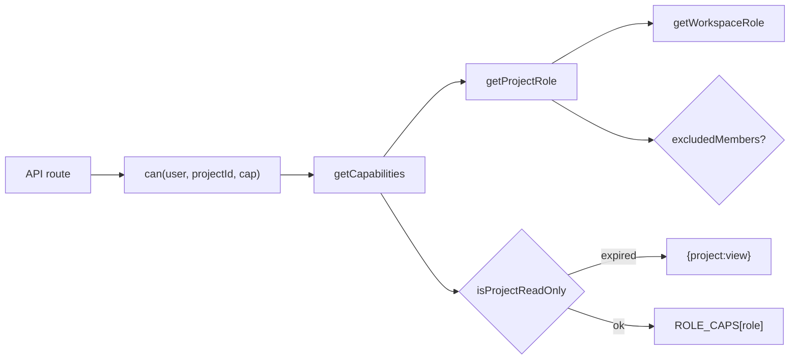

# Module: Roles, Access & Permissions

> Capability-based RBAC. Server logic in `src/lib/permissions.ts`;
> roles/capabilities in `src/lib/constants.ts`. Documents the working tree as of
> 2026-10-23, including the uncommitted read-only re-enable (see [Read-only collapse](#read-only-collapse-expired-workspace)).

## Purpose
Control who can reach what, and what they can do, with one role set applied at both
the workspace and project level — plus a billing gate that makes a lapsed workspace
view-only for everyone.

## The four roles
`src/lib/constants.ts:ROLES` = `owner | admin | editor | viewer`. `ASSIGNABLE_ROLES` (dropdowns, invites) excludes `owner`.

| Role | Can do (from `ROLE_CAPS`) |
|---|---|
| **Owner** | All capabilities. The workspace creator (`Workspace.owner`); exactly one; cannot be demoted or removed. Only the owner (or super admin) can delete the **workspace**. |
| **Admin** | All capabilities — identical cap set to owner, **including deleting a project** (`project:manage`). |
| **Editor** | Create, edit, comment on tasks; archive tasks (archive is `task:edit`); add options to multiselect fields. No delete, no sprints, no settings. |
| **Viewer** | `project:view` only. |

> [!NOTE]
> `ROLE_DESCRIPTIONS.owner` says "including deleting the workspace/project", which reads as
> owner-only. In code `ROLE_CAPS.admin === ALL_CAPS`, so admins can delete projects too.
> Only `DELETE /api/workspaces/[id]` is owner-only.

The same vocabulary is used for workspace membership and project guests (guests: admin/editor/viewer only — `ProjectMemberSchema` enum has no `owner`).

## Access model — workspace grants all projects
- **Workspace members** (`Workspace.members[]`, incl. the owner entry) automatically have that role on **every project** in the workspace. They are NOT stored in `Project.members`.
- **Project guests** are users who are NOT workspace members, given access to a **single** project (`Project.members[]`). They see only that project (`GET /api/projects` filters by `members.user`).
- **Excluded members** (`Project.excludedMembers[]`): a workspace member "removed" from one project. `getProjectRole` drops their workspace-derived role for that project only; they keep it everywhere else. Restoring = `POST /api/projects/[id]/members` with their `userId`. The workspace owner can never be excluded.
- A guest cannot be someone who is already a workspace member (API returns 409). Adding a user to the workspace `$pull`s any guest rows they had in that workspace's projects.

## Resolution & enforcement

- `src/lib/permissions.ts:getWorkspaceRole` → `owner` if `ws.owner` matches, else the member's role, else null.
- `src/lib/permissions.ts:getProjectRole` → workspace role (unless excluded) vs guest role; when both exist the higher **rank** wins. `rankOf` treats an unknown role name as rank 0 so a known workspace role (e.g. owner) is never shadowed by legacy data such as `project_admin` (see [Lessons](#lessons--past-incidents)).
- `src/lib/permissions.ts:getCapabilities` → empty set if no role; `{project:view}` if the workspace is expired; else `ROLE_CAPS[role]`.
- `src/lib/permissions.ts:can` gates every project-scoped mutating route. Project-scoped **reads** (task list, sprints list, activity, reports) check `getProjectRole` only, so viewers and read-only workspaces can still read.
- Workspace-scoped writes do NOT use capabilities: they check `src/lib/permissions.ts:isWorkspaceManager` (owner/admin) on `getWorkspaceRole`.
- `GET /api/projects/[id]` and `GET /api/tasks/[id]` return `myRole`, `myCapabilities` and `readOnly`; the UI hides controls from these. **Client gating is UX only** — the server re-checks.

## Capabilities
`src/lib/constants.ts:CAPABILITIES` — 8 values.

| Capability | owner | admin | editor | viewer | Routes gated (via `can`) |
|---|---|---|---|---|---|
| `project:view` | ✓ | ✓ | ✓ | ✓ | (reads use `getProjectRole` instead) |
| `task:create` | ✓ | ✓ | ✓ | | `POST /api/tasks`, `POST /api/tasks/[id]/duplicate` |
| `task:edit` | ✓ | ✓ | ✓ | | `PATCH /api/tasks/[id]`, `PATCH /api/tasks/bulk`, `POST /api/tasks/reorder`, `POST /api/projects/[id]/field-options` |
| `task:comment` | ✓ | ✓ | ✓ | | `POST /api/tasks/[id]/comments` |
| `task:delete` | ✓ | ✓ | | | `DELETE /api/tasks/[id]` |
| `sprint:manage` | ✓ | ✓ | | | `POST /api/sprints`, `PATCH /api/sprints/[id]`, `DELETE /api/sprints/[id]` |
| `member:manage` | ✓ | ✓ | | | `/api/projects/[id]/members` (POST/PATCH/DELETE), `/api/projects/[id]/invites` (GET/POST/DELETE) |
| `project:manage` | ✓ | ✓ | | | `PATCH /api/projects/[id]`, `DELETE /api/projects/[id]` |

Workspace-level checks (no capability):

| Action | Rule | Read-only gated? |
|---|---|---|
| Create project `POST /api/projects` | `isWorkspaceManager` | yes |
| Rename/describe workspace `PATCH /api/workspaces/[id]` | `isWorkspaceManager` | yes |
| Add member / change role `POST`/`PATCH /api/workspaces/[id]/members` | `isWorkspaceManager` | yes |
| Remove member / leave `DELETE /api/workspaces/[id]/members` | manager, or removing self | no |
| Delete workspace `DELETE /api/workspaces/[id]` | `Workspace.owner` or super admin | no |
| Change plan fields on `PATCH /api/workspaces/[id]` | super admin only | n/a |

## Read-only collapse (expired workspace)
When `src/lib/plans.ts:resolveStatus` returns `expired` for a workspace, **every** role on
every project in it — owner included — collapses to `{project:view}`. Details of the
billing side live in [07-billing-plans.md](07-billing-plans.md).

Enforcement points:
- `src/lib/permissions.ts:getCapabilities` → `isProjectReadOnly` → `isWorkspaceExpired`. Gates every `can()` route in the table above.
- Direct checks returning `READ_ONLY_MESSAGE` (403): `POST /api/projects`, `PATCH /api/workspaces/[id]` (non-plan edits), `POST`/`PATCH /api/workspaces/[id]/members`.
- Still allowed while expired: reading, leaving/removing workspace members, leaving a project (self-remove skips `can`), accepting/declining invites (`PATCH /api/invites/[id]`), deleting the workspace, creating a **new** workspace, and per-user data (dashboards, saved filters, notifications).
- UI: `src/components/project/common.tsx:useProject` exposes `readOnly`; `ProjectHeader` shows a red lock banner; the Workspaces page hides "New project", the invite form and disables role selects (`src/app/(app)/workspaces/page.tsx`).

> [!WARNING]
> Each `can()` call runs 3–4 Mongo reads (`Project` twice, `Workspace` twice). Routes that loop
> over projects (`PATCH /api/tasks/bulk`) multiply this. Don't add `can()` calls inside per-task loops.

## Super admin
- Anchored to one email: `src/lib/constants.ts:SUPER_ADMIN_EMAIL`, checked by `isSuperAdminEmail` (case-insensitive) / `src/lib/permissions.ts:isSuperAdmin`. The DB `User.role` (`super_admin|member`) is synced at register/login for display only and is **not** trusted for authorization.
- Grants: `/admin` page (gated in `src/middleware.ts:middleware` and again client-side), `GET /api/workspaces?all=1`, plan fields on `PATCH /api/workspaces/[id]`, deleting any workspace, `GET /api/users?all=1` (includes inactive), `PATCH /api/users/[id]`.
- Does **not** grant access to projects/tasks in workspaces the super admin isn't a member of. See [08-super-admin.md](08-super-admin.md).

## Where roles are managed (UI)
- **Workspace members** — Workspaces page → gear icon → *Workspace settings* modal (owner chip locked; others admin/editor/viewer). Invite by email requires an **existing active account**; grants access to all projects.
- **Project guests & exclusions** — Project → **Settings** → *Team access* (workspace members, with per-project *Remove* / *Restore access*) and *Project guests* (email invites, role select, remove). See [06-workspaces-projects.md](06-workspaces-projects.md).

## Key journeys
| Journey | Path |
|---|---|
| Happy path | Admin invites `dev@team.in` as editor on the workspace → dev sees every project, can create/edit/comment, cannot see Settings controls or delete. |
| Permission branch | Viewer opens a task → `myCapabilities = [project:view]` → TaskModal fields read-only; a forged `PATCH /api/tasks/[id]` returns 403 "You don't have permission…". |
| Read-only branch | Trial lapses → owner opens board → red banner, no drag/quick-add; `POST /api/tasks` returns 403. Super admin assigns a plan → caps return on next refetch. |
| Failure | Legacy role string in DB (e.g. `developer`) → `ROLE_CAPS[...]` undefined → user gets an empty cap set and 403s everywhere. Fix data with a root migration, never add ad-hoc role names. |

## API dependencies
- [api/workspaces.md](../api/workspaces.md) — workspace roles, plan fields, invites inbox.
- [api/projects.md](../api/projects.md) — project guests, exclusions, invites.

## Lessons / past incidents
- **Role taxonomy mismatch (2026-07-29, `930db0f`).** Live data carried roles from an earlier model (`workspace_admin`, `member`, `project_admin`, `developer`). Unknown roles produced an empty cap set, and `RANK[ws] >= RANK[unknown]` (`4 >= undefined` → false) let an unknown guest role shadow even the owner. Fixed by `rankOf` in `getProjectRole` plus a root `migration.js` that mapped `workspace_admin→admin`, `member→editor`, `project_admin→admin`, `developer→editor`. The invite form also reset its role to the invalid `"member"`; now `"editor"`. Rule: new roles must be added to `ROLES`/`ROLE_CAPS`/`RANK`, both schema enums and the dropdowns together. <!-- verify:ignore -->
- **Read-only lock removed then re-enabled.** Added in `22ff6f3`; removed in `930db0f` (v1 billing "display-only") because paid workspaces still stored `subscriptionStatus: "trialing"` with a past `trialEndsAt` and admins lost edit/comment rights. Re-enabled 2026-10-22 (uncommitted) at the owner's request; the stale-trial problem is avoided because assigning a paid plan in `/admin` sets `subscriptionStatus: "active"`.

> [!TODO]
> The root `migration.js` referenced above (and in `src/lib/constants.ts` / `src/models/index.ts` comments) is not in the working tree or git history at `5ec7e9c`. Whether it was run against production and where its source lives needs a human. <!-- verify:ignore -->

## Removed
The earlier per-project role set (project_admin/team_lead/developer/qa/viewer) and the
workspace **custom-roles builder** were replaced by this four-role model in `193e077` (2026-07-24; `8a661eb` still had `PROJECT_ROLES`). <!-- verify:ignore -->
