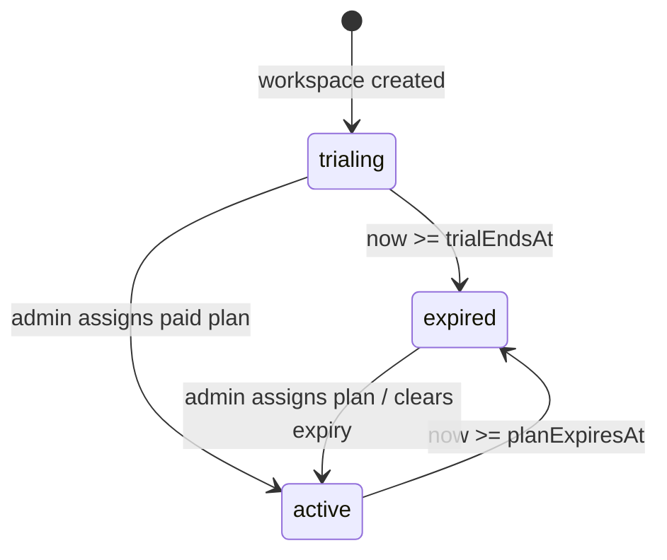

# Module: Billing & Plans

> Single source of truth: `src/lib/plans.ts`. Plans are sold **per workspace**, priced per seat in INR
> (exclusive of 18% GST), and assigned manually by the super admin — there is **no payment gateway**.
> Documents the working tree as of 2026-10-23 (read-only enforcement re-enabled 2026-10-22, uncommitted).

## Purpose
Track each workspace's plan and trial/paid entitlement, show it to users, and lock a lapsed workspace into read-only mode until the super admin assigns a plan.

---

## Business Value
Kanbo is a hosted SaaS for small Indian software teams. The trial converts to a paid plan; the read-only lock is the only lever that makes the trial end mean something.

---

## Plan tiers (`src/lib/plans.ts:PLANS`)
Prices are integers in **paise** (₹1 = 100 paise); format with `formatPrice` (`null` → "Custom", `0` → "Free"). `Infinity` = unlimited (`formatLimit`).

| Plan id | Monthly / user | Annual / user | Seats | Projects | Sprints/project | Guests | Custom fields/project | Dashboards | Storage | Activity days | Support |
|---|---|---|---|---|---|---|---|---|---|---|---|
| `trial` (legacy) | 0 | — | 15 | ∞ | ∞ | ∞ | ∞ | ∞ | 5 GB | 180 | Email |
| `pro` | 14900 (₹149) | 12500 (₹125) | 15 | 15 | 5 | 5 | 10 | 5 | 5 GB | 180 | Email |
| `business` | 29900 (₹299) | 24900 (₹249) | 50 | ∞ | ∞ | ∞ | ∞ | ∞ | 50 GB | ∞ | Priority |
| `enterprise` | null (contact sales) | null | ∞ | ∞ | ∞ | ∞ | ∞ | ∞ | ∞ | ∞ | Dedicated |

> [!IMPORTANT]
> Per-tier caps are **display-only** (landing page `src/app/page.tsx`, admin dropdown). No route reads `PLANS[...].limits`; nothing enforces seats, projects, sprints, guests, dashboards or storage.

---

## Lifecycle & state
Workspace fields (schema in [database/entities.md](../database/entities.md#entity-workspace)): `plan`, `subscriptionStatus`, `trialEndsAt`, `planExpiresAt`.

| Event | Stored values |
|---|---|
| `POST /api/workspaces` (schema defaults) | `plan: "pro"`, `subscriptionStatus: "trialing"`, `trialEndsAt: now + 15d`, `planExpiresAt: null` |
| Super admin picks a paid plan | `plan`, `subscriptionStatus: "active"` (set together by the admin UI) |
| Super admin picks `trial` | `plan: "trial"`, `subscriptionStatus: "trialing"` (trial clock **not** reset) |
| Super admin sets expiry date | `planExpiresAt` (ISO) or `null` |

Derived status — never written back to the DB:
- `src/lib/plans.ts:entitlementEndsAt` → `trialEndsAt` when stored status is `trialing`, else `planExpiresAt`; `null` = never ends.
- `src/lib/plans.ts:resolveStatus` → `expired` if stored `expired` or the end date has passed; else `active` if stored `active`; else `trialing`. `now` is injectable.
- `src/lib/plans.ts:daysRemaining` → whole days (ceil) until end, 0 if lapsed or no date.

---

## Read-only enforcement points
Full table in [04-roles-permissions.md](04-roles-permissions.md#read-only-collapse-expired-workspace). Summary:
1. `src/lib/permissions.ts:getCapabilities` → `isProjectReadOnly` → `isWorkspaceExpired` collapses every role to `{project:view}` — covers all task, comment, sprint, project-settings, project-member and project-invite writes.
2. Direct `isWorkspaceExpired` + `READ_ONLY_MESSAGE` (403) in `POST /api/projects`, `PATCH /api/workspaces/[id]` (name/description), `POST`/`PATCH /api/workspaces/[id]/members`.
3. `readOnly` flag in `GET /api/projects/[id]` and `GET /api/tasks/[id]` → `useProject().readOnly`, `ProjectHeader` banner, TaskModal, board/backlog/list controls.

---

## Screens & UI
| Where | What | Source |
|---|---|---|
| Top bar (inside a project) | `PlanBadge` for the active project's workspace | `src/components/AppShell.tsx` |
| Workspaces page cards | `PlanBadge` per workspace | `src/app/(app)/workspaces/page.tsx` |
| `/admin` → Plans & subscriptions | plan/status selects, expiry date, stats, est. MRR | `src/app/(app)/admin/page.tsx:PlansDashboard` — see [08-super-admin.md](08-super-admin.md) |
| Landing `/` | pricing cards from `PLANS`, `TRIAL_DAYS` copy, GST note | `src/app/page.tsx` |

`src/components/PlanBadge.tsx:PlanBadge` — plan chip (Crown icon, plan color); while `trialing`, a countdown chip ticking every 30 s (every 1 s under 24 h) that turns amber at ≤3 days and red at ≤1 day; when `expired`, a red "Expired · read-only" lock chip. Renders nothing if `ws.plan` is missing. The admin page has its own simpler local `PlanBadge`. Props: [ui/primitives.md](../ui/primitives.md).

---

## How the super admin assigns a plan
1. `/admin` → table row → **Plan** select → `useSetWorkspacePlanMutation` sends `{plan, subscriptionStatus}` (`trial`→`trialing`, else `active`).
2. Optional: **Status** select (`trialing|active|expired`) and **Renews / expires** date (`planExpiresAt`).
3. `PATCH /api/workspaces/[id]` accepts plan fields only from `isSuperAdmin` (403 otherwise) and logs `workspace.plan_changed`.
4. The mutation patches the `getWorkspacesList("/api/workspaces?all=1")` cache optimistically and rolls back on error (`src/store/api.ts:setWorkspacePlan`).

---

## Known gaps
| Gap | Evidence |
|---|---|
| Workspaces missing plan fields never expire | `resolveStatus` with no `subscriptionStatus`/dates → `trialing`; `PlanBadge` hides itself when `plan` is absent. Mongoose defaults apply only to new docs; no backfill exists in the repo. |
| Fresh trial on demand | Any user can `POST /api/workspaces` (no expiry/ownership check) and get a new 15-day trial. |
| Trial can't be extended from the UI | `trialEndsAt` is not in the `PATCH /api/workspaces/[id]` schema; switching back to `trial` keeps the old (lapsed) date. |
| Stale `planExpiresAt` | Assigning a paid plan doesn't clear a past `planExpiresAt`, so the workspace stays `expired` until the date is cleared/changed. |
| Caps display-only | No reads of `PLANS[...].limits` outside display code. |
| Est. MRR is approximate | `active` workspaces × `members.length` (owner included) × `priceMonthly`; ignores annual pricing and GST. |
| Open project pages don't refresh `readOnly` after a plan change | `setWorkspacePlan` invalidates only `Workspaces`, not `Project`. |

### Contradictions in code/copy
- `TRIAL_DAYS = 15`, and the schema default hard-codes `15 * 24 * 60 * 60 * 1000` (not `TRIAL_DAYS`). But the `plans.ts` header comment, `PLANS.trial.tagline`, the landing-page meta description and the admin page text still say **14-day**.
- `plans.ts` header says new workspaces start on the `trial` plan with Business-level features; the schema default is `plan: "pro"` (badge shows **Pro** during trial). Landing copy promises "Full Business features free".
- `plans.ts` header says "nothing is hard-blocked except (later) the trial gate" — the trial gate is now live.

---

## Migrations
> [!TODO]
> No `migration*.js` file exists at the repo root or anywhere in git history at `5ec7e9c`. Team notes describe `migration.js` (business-plan grandfathering / legacy role normalization) and `migration.202607290000.js` (all workspaces → `pro` + 15-day trial, idempotent, `--down` revert) run against the `.env` `MONGODB_URI`. Their source and whether they ran in production need a human. Any new plan field or backfill must ship a root migration per root `AGENTS.md`. <!-- verify:ignore -->

---

## Key journeys
| Journey | Steps |
|---|---|
| Happy path | Team signs up → workspace on Pro trial, badge "Trial · 14d 23h left" → before expiry, owner contacts sales → super admin sets Pro/active → badge shows Pro, no countdown. |
| Read-only branch | Trial passes `trialEndsAt` → next request resolves `expired` → all writes 403, banner shown, badge "Expired · read-only" → super admin assigns plan → editing returns after refetch. |
| Failure | Super admin sets a paid plan on a workspace whose `planExpiresAt` is in the past → status still `expired`; fix by clearing the date. Non-super-admin sending `plan` → 403 "Only the super admin can change a workspace's plan". |

---

## Decision history
| Date / SHA | Decision |
|---|---|
| `22ff6f3` (2026-07-29) | Plans + per-workspace billing + read-only lock introduced. |
| `930db0f` (2026-07-29) | Lock removed: v1 made display-only after paid workspaces stuck at `trialing` with a lapsed `trialEndsAt` locked admins out. |
| 2026-10-22 (uncommitted) | Lock re-enabled at owner request ("trial over → read-only"); paid assignment now sets `active` so stale trials don't lock paying customers. |

---

## Development Tasks (Next Phases)
> [!TODO]
> No payment gateway, invoicing or cap-enforcement plan is recorded in the repo. Pricing/GST invoicing commitments on the landing page need a product owner.
